# Flask + MySQL + Apache com Docker Compose

Trabalho do 4º bimestre de **Redes e Administração de Sistemas (RASI)** – IFSP, Campus Campos do Jordão.

- **Autores:** Gabriel Oliveira de Lima e Luisa Domiciano Morgado
- **Professor:** Cesar Augusto de Moraes Costa
- **Repositório de referência:** [CesarAugusto88/RAS-Docker](https://github.com/CesarAugusto88/RAS-Docker)

## Sobre o projeto

Aplicação web em **Python Flask** executada em containers Docker. O projeto evolui de um único container (Flask) para uma arquitetura com **três serviços** orquestrados pelo **Docker Compose**:

| Serviço  | Imagem                         | Função                                                        |
|----------|--------------------------------|---------------------------------------------------------------|
| `db`     | `mysql:8.0`                    | Banco de dados MySQL, com volume `mysql_data` para persistência |
| `flask`  | build local (`python:3.14-slim`) | Aplicação Flask; consulta o MySQL                             |
| `server` | `httpd:2.4`                    | Apache como **proxy reverso**; ponto de entrada da aplicação (porta 80) |

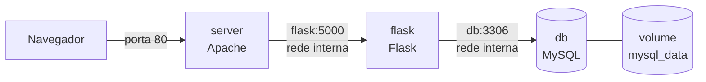

## Estrutura do projeto

```
TRABALHO-DOCKER-Gabriel-Luisa/
├── app/
│   ├── app.py              # aplicação Flask (rotas e conexão com o MySQL)
│   └── requirements.txt    # Flask==3.1.2 e mysql-connector-python
├── imagens/                # prints usados neste README
├── .dockerignore           # arquivos ignorados no build da imagem
├── .env                    # senhas (NÃO é versionado)
├── .gitignore              # ignora .env, __pycache__/ e *.pyc
├── Dockerfile              # imagem do serviço flask
├── compose.yaml            # orquestração dos três serviços
├── httpd.conf              # configuração do Apache (proxy reverso)
└── README.md
```

| Arquivo | Papel |
|---|---|
| `Dockerfile` | Constrói a imagem do Flask a partir de `python:3.14-slim`: copia o `requirements.txt`, instala as dependências, copia o código e inicia `python app.py` na porta 5000. |
| `compose.yaml` | Define os serviços `db`, `flask` e `server`, a ordem de inicialização (`depends_on` + healthcheck), o volume `mysql_data` e as variáveis de ambiente. |
| `httpd.conf` | Configura o Apache para encaminhar tudo (`/`) para `http://flask:5000/` com `ProxyPass` e `ProxyPassReverse`. |
| `.env` | Guarda `MYSQL_ROOT_PASSWORD` e `MYSQL_PASSWORD`, lidas pelo Compose. Fica fora do Git. |

## Rotas da aplicação

| Rota        | Descrição                                                    |
|-------------|--------------------------------------------------------------|
| `/`         | Página inicial                                               |
| `/sobre`    | Sobre o projeto                                              |
| `/contato`  | Contato (IFSP – Campus Campos do Jordão)                     |
| `/alunos`   | Lista de alunos buscada **dinamicamente** no MySQL           |

## Pré-requisitos

- Docker Engine com o plugin Docker Compose (testado com Docker 29.8.0)
- Uma VM ou máquina Linux (usamos Ubuntu Server 26.04.1 LTS no VirtualBox)

## Como executar

**1. Clonar o repositório e entrar na pasta do projeto**

```bash
git clone https://github.com/GabrielOliveira1994/TRABALHO-DOCKER.git
cd TRABALHO-DOCKER/TRABALHO-DOCKER-Gabriel-Luisa
```

**2. Criar o arquivo `.env`** (as senhas são exigidas pelo Compose; sem elas a subida é interrompida)

```env
MYSQL_ROOT_PASSWORD=sua_senha_root
MYSQL_PASSWORD=sua_senha_flask
```

**3. Subir os serviços**

```bash
docker compose up -d --build
docker compose ps
```

Aguarde o serviço `db` aparecer como `healthy` (na primeira vez pode levar cerca de 30 segundos).

**4. Criar a tabela `alunos`** (apenas na primeira execução)

```bash
docker compose exec db mysql -u flaskuser -p meu_banco
```

```sql
CREATE TABLE IF NOT EXISTS alunos (
  id INT AUTO_INCREMENT PRIMARY KEY,
  nome VARCHAR(100) NOT NULL
);

INSERT INTO alunos (nome) VALUES
  ('Gabriel Oliveira de Lima'),
  ('Luisa Domiciano Morgado');
```

**5. Acessar**

- Na própria VM: `http://localhost`
- De outra máquina: `http://IP_DA_VM` (porta 80, via Apache)
- Em nosso ambiente (VirtualBox em NAT), com o redirecionamento 8080 → 80: `http://localhost:8080`

A porta 5000 do Flask também está publicada (útil para testes diretos), mas o acesso normal à aplicação é pela porta 80, via Apache.

## Variáveis de ambiente

| Variável | Usada por | Origem |
|---|---|---|
| `MYSQL_ROOT_PASSWORD` | `db` (e healthcheck) | `.env` |
| `MYSQL_PASSWORD` | `db` e `flask` (como `DB_PASSWORD`) | `.env` |
| `DB_HOST=db`, `DB_PORT`, `DB_NAME`, `DB_USER` | `flask` | `compose.yaml` |

O `app.py` lê essas variáveis com `os.environ`; nenhuma credencial fica no código.

## Teste de persistência

Os dados ficam no volume nomeado `mysql_data`. Recriar os containers não apaga os registros:

```bash
docker compose down        # remove containers e rede (o volume é preservado)
docker compose up -d       # recria os containers
docker compose ps          # db deve voltar como healthy
```

Em seguida, acesse `/alunos`: os registros continuam lá. Para apagar também os dados, use `docker compose down -v`.

> As variáveis `MYSQL_DATABASE`, `MYSQL_USER` e as senhas só são aplicadas na **primeira** inicialização, com o volume vazio.

## Atualizando a aplicação

| O que mudou | O que fazer |
|---|---|
| `app/app.py` (código) | `docker compose restart flask` (a pasta `./app` é montada em `/app`) |
| `requirements.txt` ou `Dockerfile` | `docker compose up -d --build` |
| `httpd.conf` | `docker compose restart server` |

## Comunicação entre os serviços

- O Compose cria uma rede interna e cada serviço é encontrado pelo **nome**: por isso `DB_HOST=db` e `ProxyPass / http://flask:5000/`.
- `ports` publica uma porta no host (`80:80` no Apache e `5000:5000` no Flask, este para testes diretos); `expose` apenas disponibiliza a porta para os outros containers da rede, sem publicá-la. O MySQL não publica nenhuma porta (3306 só na rede interna). Em produção, o ideal é trocar o `ports` do Flask por `expose: - "5000"`, deixando o Apache como único ponto de entrada.
- O `depends_on` com `condition: service_healthy` faz o Flask esperar o MySQL ficar saudável (`mysqladmin ping`).

## Segurança

- Senhas no `.env`, listado no `.gitignore`, e exigidas pelo Compose via `${VARIAVEL:?mensagem}`.
- A aplicação usa o usuário `flaskuser`, não o `root`.
- `httpd.conf` montado como somente leitura (`:ro`) e `ProxyRequests Off` (somente proxy reverso).
- Limitação: o servidor de desenvolvimento do Flask não é indicado para produção; em um ambiente real, usar um servidor WSGI (ex.: Gunicorn) e Docker secrets.

## Ambiente utilizado (VM e SSH)

- VirtualBox com Ubuntu Server 26.04.1 LTS, rede em modo **NAT**.
- Redirecionamento de portas: `2222 → 22` (SSH), `8080 → 80` (Apache) e `5000 → 5000` (Flask).
- Acesso remoto a partir do Windows:

```bash
ssh aluno@localhost -p 2222
```

## Evidências

### Parte A e B – VM, SSH e Docker

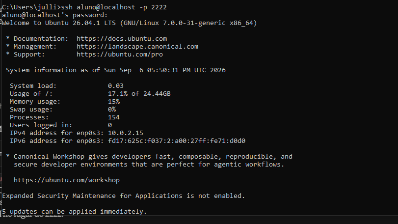

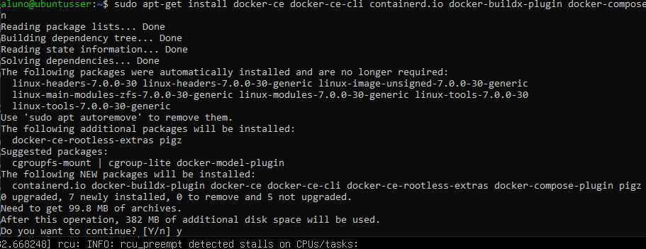

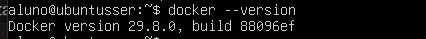

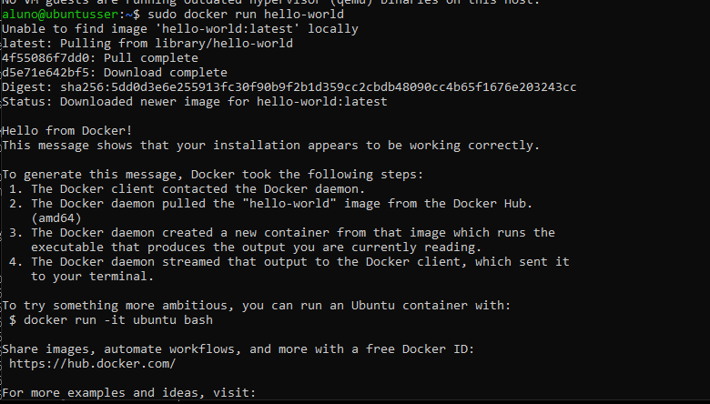

### Parte C – Flask em um único container

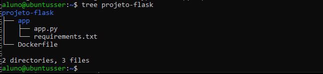

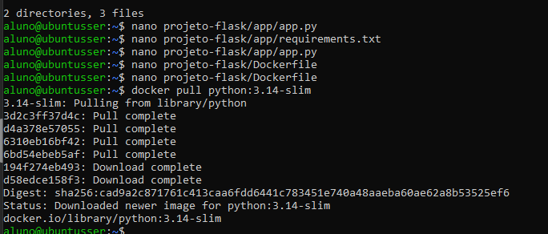

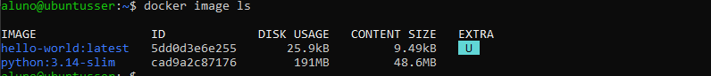

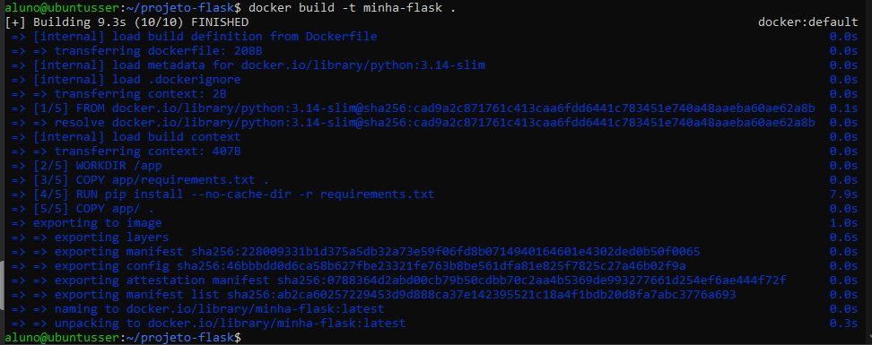

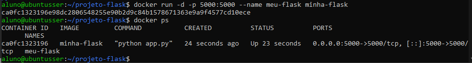

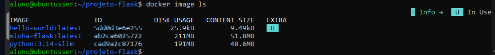

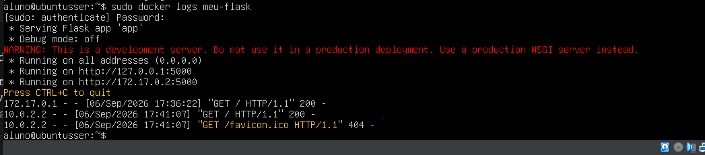

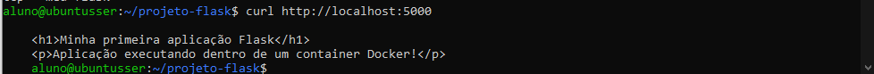

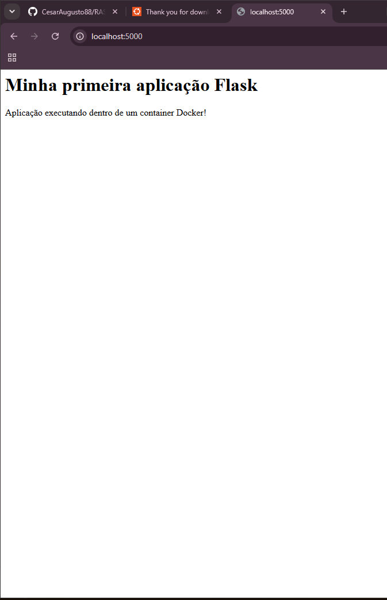

*Figura 13 – Aplicação no navegador*

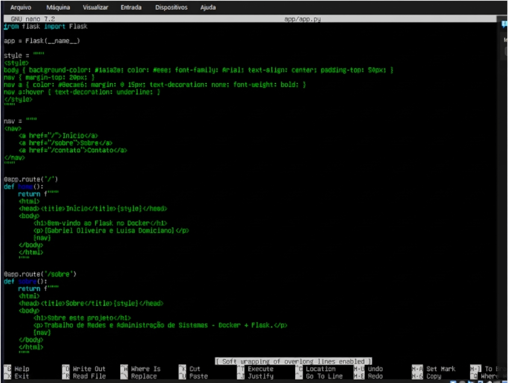

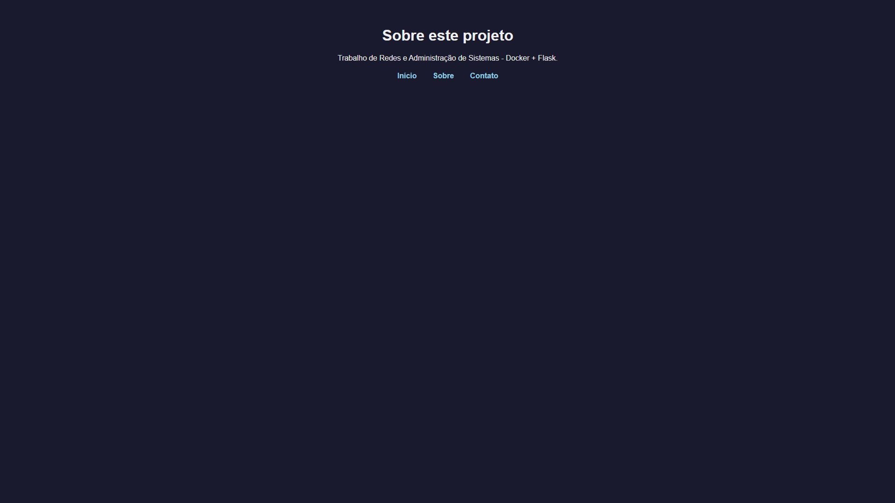

### Parte D – Docker Compose

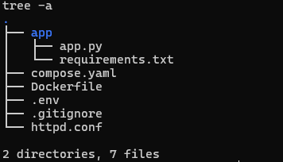

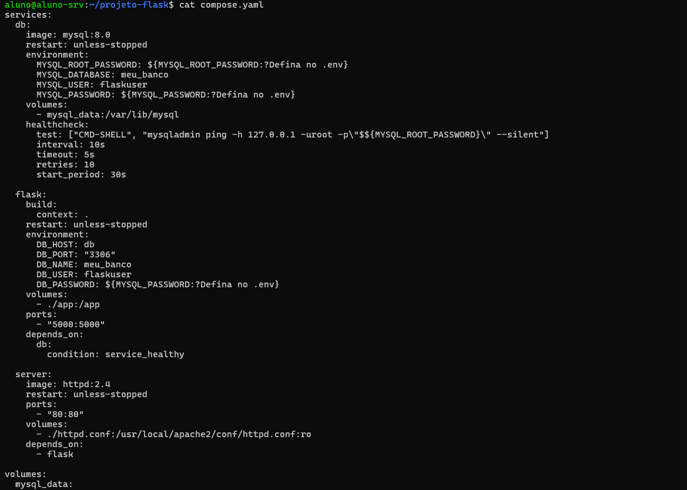

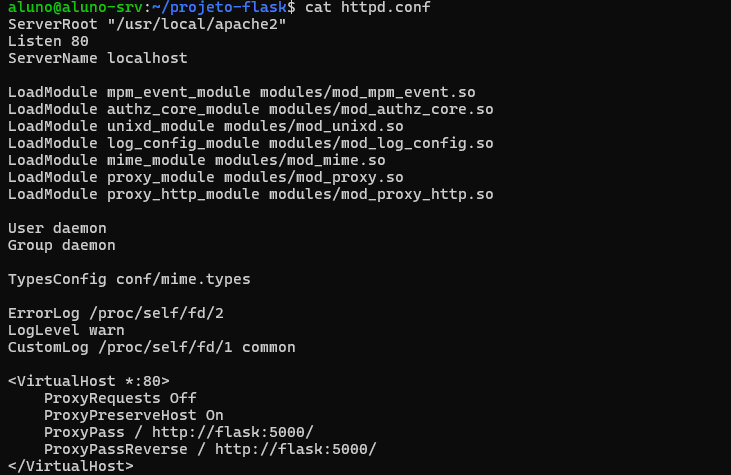

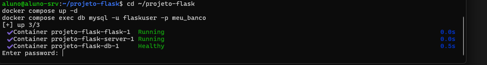

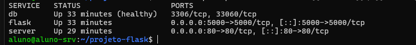

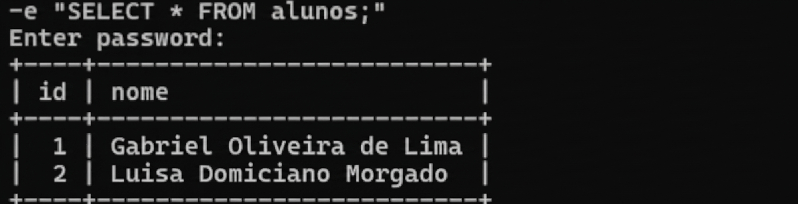

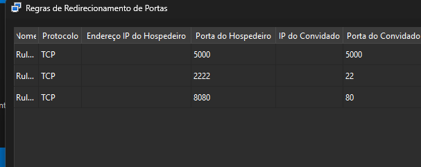

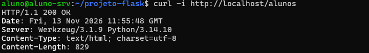


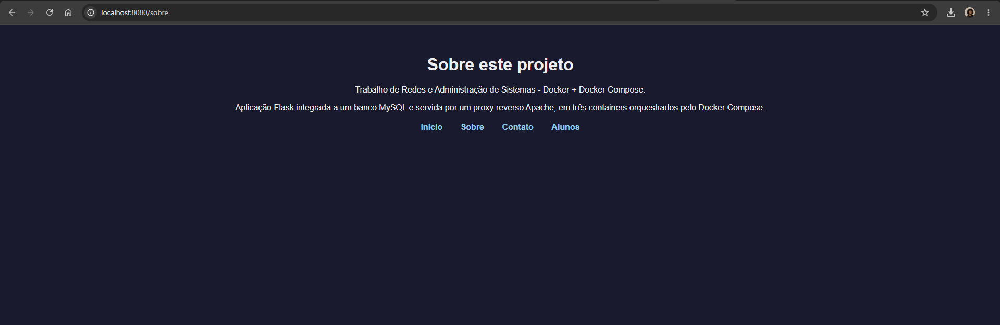

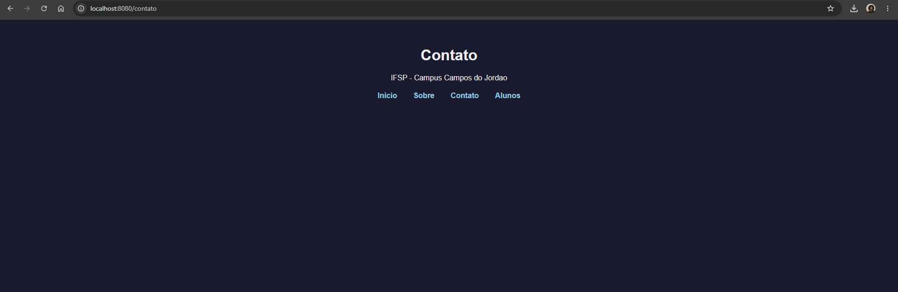


## Referências

- Docker. *Docker Documentation*. <https://docs.docker.com>
- Docker. *Docker Compose*. <https://docs.docker.com/compose/>
- Pallets. *Flask Documentation*. <https://flask.palletsprojects.com/>
- Apache Software Foundation. *mod_proxy*. <https://httpd.apache.org/docs/2.4/mod/mod_proxy.html>
- Oracle. *MySQL 8.0 Reference Manual*. <https://dev.mysql.com/doc/refman/8.0/en/>
- Costa, C. A. M. *RAS-Docker* (repositório de referência). <https://github.com/CesarAugusto88/RAS-Docker>
